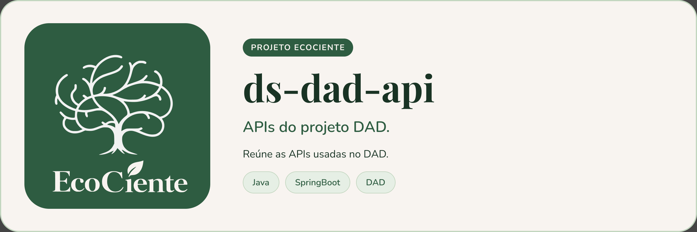
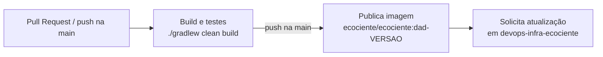

<p align="center">
  
</p>

# DAD API (ds-dad-api)


> API do DAD do EcoCiente, em Spring Boot. Por enquanto o repositório contém apenas o esqueleto do projeto (versão 1.0.0).

## Sobre o projeto

O projeto está em fase inicial: há a classe principal, a documentação OpenAPI via springdoc (`/swagger-ui.html`) e a pipeline de CI/CD, mas **nenhum endpoint, banco de dados ou autenticação implementados ainda**.

### Pipeline



A tag da imagem é montada a partir da `version` do `build.gradle` e é imutável: para publicar de novo, aumente a versão.

## Pré-requisitos

- JDK 19
- Docker (opcional, para executar em contêiner)

## Instalando

```bash
git clone https://github.com/EcoCiente-Instituto-J-F/ds-dad-api.git
cd ds-dad-api
cp .env.example .env      # Windows (PowerShell): Copy-Item .env.example .env
```

O `.env.example` define apenas `APP_PORT` (porta publicada pelo Docker Compose, padrão 8080).

## Usando

```bash
./gradlew bootRun            # Windows: .\gradlew.bat bootRun
docker compose up --build    # aplicação em http://localhost:${APP_PORT:-8080}
```

Documentação interativa: `http://localhost:8080/swagger-ui.html`.

## Testes

```bash
./gradlew clean build --no-daemon   # mesmo comando do CI
```

## Estrutura do projeto

```
.
├── .github/workflows/   # ci.yml (build, imagem, infraestrutura) e pr-bot.yml
├── scripts/pr-bot/      # bot que gera a descrição das PRs
├── src/main/java/       # código da aplicação
├── src/main/resources/application.properties
├── src/test/java/       # testes
├── build.gradle
├── Dockerfile
└── docker-compose.yml
```

## Contribuindo

Leia o [CONTRIBUTING.md](CONTRIBUTING.md) antes de abrir uma Pull Request. Ao participar, você concorda com o [Código de Conduta](CODE_OF_CONDUCT.md).

## Segurança

Encontrou uma vulnerabilidade? Siga o [SECURITY.md](SECURITY.md). **Não abra issue pública.**

## Licença

Este projeto está sob a licença MIT. Veja o arquivo [LICENSE](LICENSE).
